# CircuTrace

**Enterprise Digital Product Passport & Circular Lifecycle Intelligence Platform**

> Make product identity, material provenance and circular lifecycle evidence easier to verify across the value chain.

CircuTrace is a MERN-oriented platform project connecting product identity, supplier data, bill-of-materials context, lifecycle events and evidence-backed passport information.

## 1. Project status

**Main branch: application foundation and architecture scaffold.** Product/material registry and lifecycle/passport capabilities are being developed in feature branches and should not be represented as released main-branch functionality until merged. No regulatory certification or live EU DPP Registry integration is claimed.

## 2. Why CircuTrace

Product information is fragmented across manufacturers, suppliers, repairers, logistics providers and recyclers. CircuTrace is designed to connect persistent product identity, material provenance, supplier declarations, lifecycle events, repair/reuse/recovery workflows, approved public disclosures and data-quality signals.

## 3. Product capability map

| Domain | Capability direction |
| --- | --- |
| Digital passport | Product identity, attributes, ownership and lifecycle summary |
| Composition | BOM, components, material classifications and origin |
| Supplier network | Partner onboarding, declarations and risk signals |
| Traceability | Sourcing, production, custody and distribution events |
| Evidence vault | Versioned documents, attestations and review states |
| Compliance | Configurable requirements, control mapping and evidence gaps |
| Circularity | Repair, refurbishment, reuse, resale and recovery |
| Public verification | QR / Digital Link entry point with field-level disclosure |
| Intelligence | Data completeness, provenance confidence and explainable indicators |

## 4. Technology and architecture

- **Web:** React, TypeScript, Vite and Tailwind CSS.
- **API:** Node.js, Express and TypeScript.
- **Data:** MongoDB and Mongoose.
- **Client data:** TanStack Query; Zustand only where shared state is justified.
- **Workspace:** pnpm/Turborepo modular monolith foundation.
- **Async/realtime:** Redis, BullMQ and Socket.IO when workload needs justify them.
- **Quality:** automated tests, static analysis and end-to-end coverage as milestones land.

Design principles: tenant isolation at API/data boundaries; claims bound to issuer/evidence/timestamp/review state; provenance-preserving lifecycle events; untrusted external data validation; public/restricted field separation; explainable circularity metrics; jurisdiction-aware product rules.

## 5. Local development

Prerequisites: Node.js LTS, pinned pnpm version, Docker and MongoDB.

    pnpm install --frozen-lockfile
    pnpm dev
    pnpm typecheck
    pnpm test
    pnpm build

Use [local setup](docs/development/local-setup.md) and branch-specific scripts. Keep secrets in local environment files only.

## 6. Industry alignment: Digital Product Passport

The EU Ecodesign for Sustainable Products Regulation (ESPR) establishes the legal basis for the Digital Product Passport, with product-specific requirements introduced progressively. Passport information may include origin, materials, repairability, environmental performance, reuse and recycling; certain battery categories are an early mandatory use case.

Product directions:
- Product-group-specific data schemas and versioned disclosure rules.
- QR / Digital Link resolution to a stable passport identifier.
- Role-based access for public, business and authority-facing fields.
- Evidence provenance, issuer verification and change history.
- Battery lifecycle data readiness and restricted-access handling.
- Exportable evidence packs and machine-readable APIs.

Reference: [European Commission — Digital Product Passport](https://single-market-economy.ec.europa.eu/single-market/digital-product-passport_en). A passport data model alone does not establish legal compliance or registry connectivity.

## 7. Security and responsible claims

- Supplier declarations are not independently verified facts by default.
- Do not label a product compliant without applicable legal assessment and evidence.
- Protect trade secrets and personal data through field-level disclosure and access control.
- Use synthetic supplier, product and lifecycle data in demos.
- Production requires regulatory mapping, security review, partner controls, audit retention, backup/restore and independent verification.

## 8. Illustrative dashboard gallery

These 12 SVGs are **illustrative dashboard concepts**, not screenshots of a deployed product. All figures, products, suppliers and evidence are synthetic. The gallery is presented in a single-column sequence.

### 01. Product Passport Command Center
Portfolio view of passport readiness, evidence coverage and lifecycle exceptions.

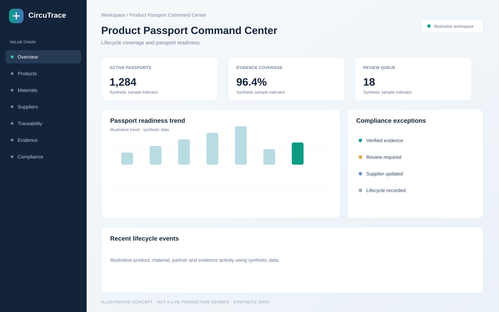

### 02. Product Identity Registry
Persistent product identifiers, master-data completeness and identity validation.

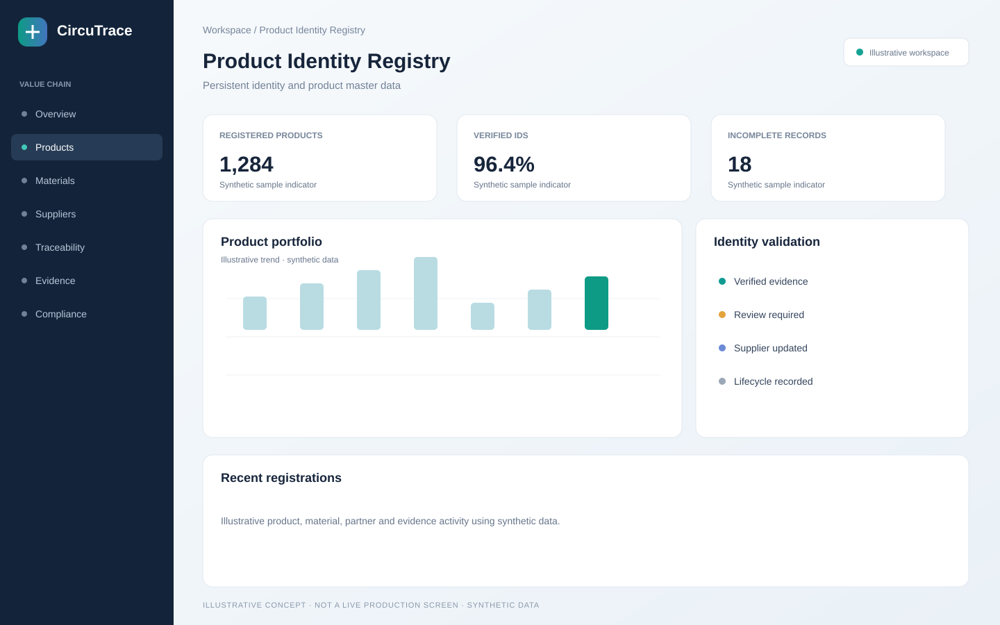

### 03. Bill of Materials Explorer
Component and material breakdown linked to supplier origin and change history.

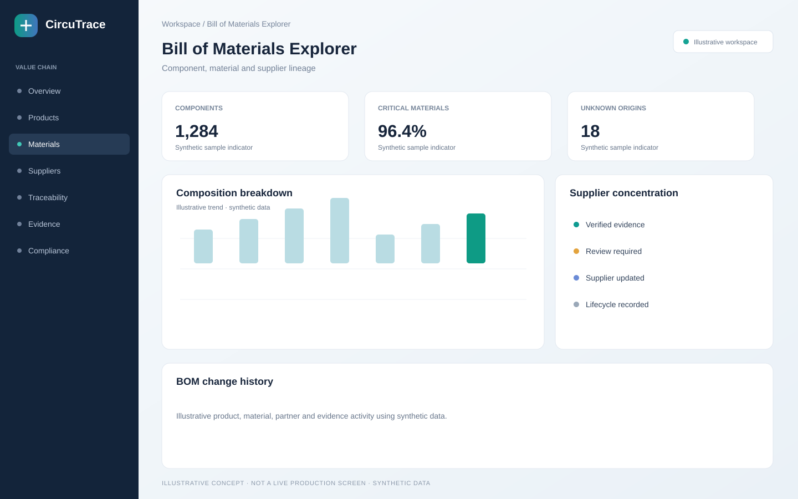

### 04. Supplier Trust Network
Supplier onboarding, declaration status and evidence freshness.

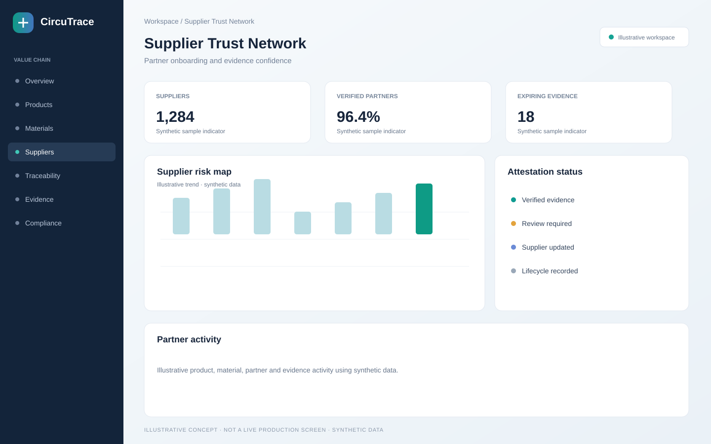

### 05. Material Provenance Trace
Chain of custody for material origin, transformation and provenance gaps.

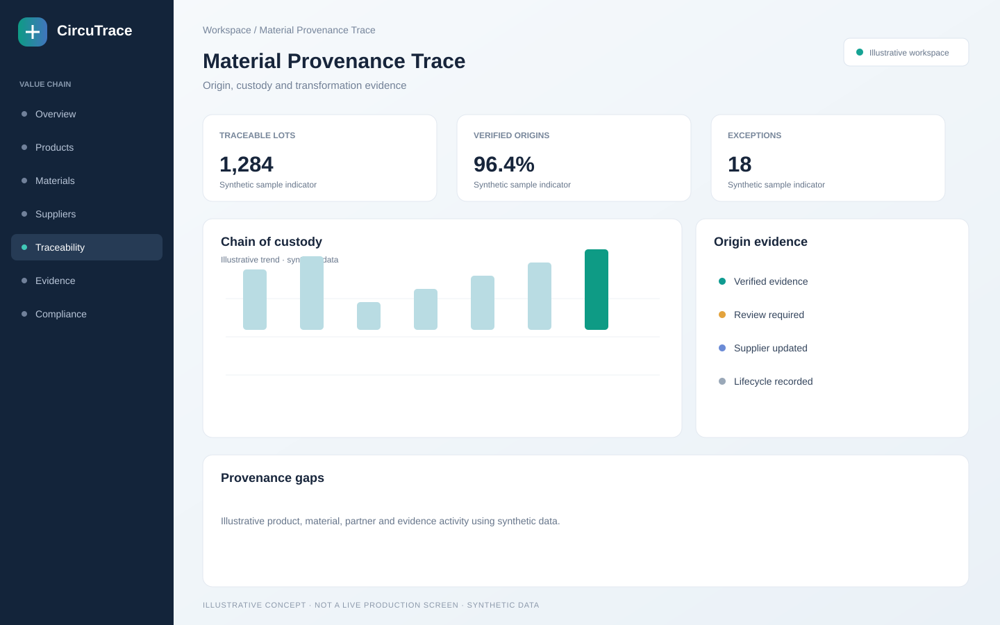

### 06. Lifecycle Event Timeline
Accountable manufacture, distribution, repair and recovery events.

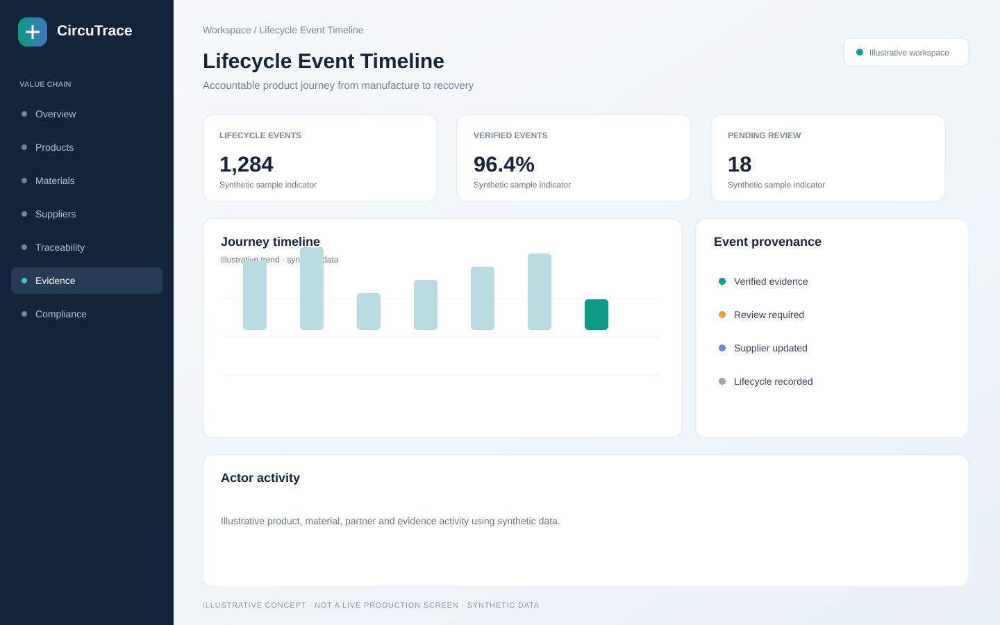

### 07. Evidence Vault
Versioned evidence, attestations and review outcomes.

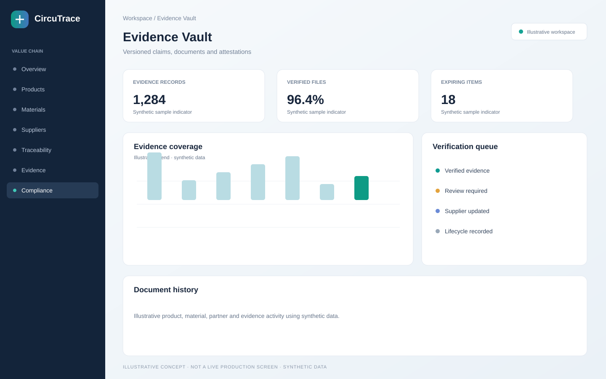

### 08. Compliance Readiness
Requirement-to-evidence mapping, completeness and review planning.

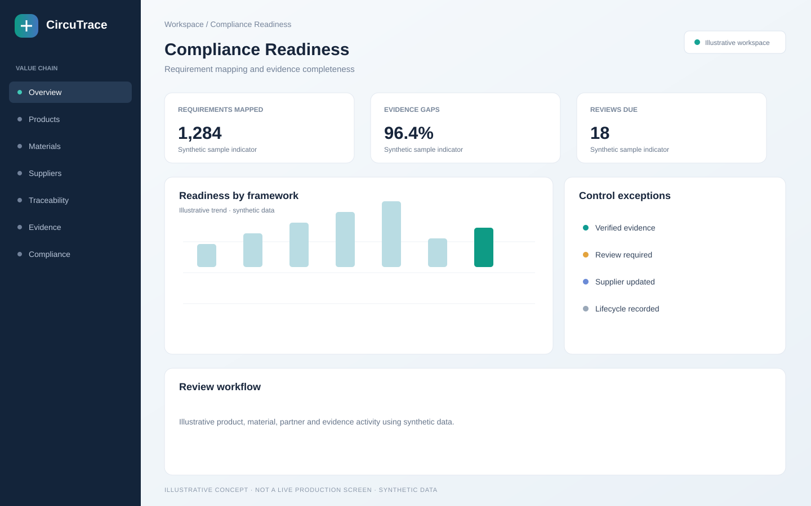

### 09. Circularity Performance
Repair, reuse, refurbishment and end-of-life recovery signals.

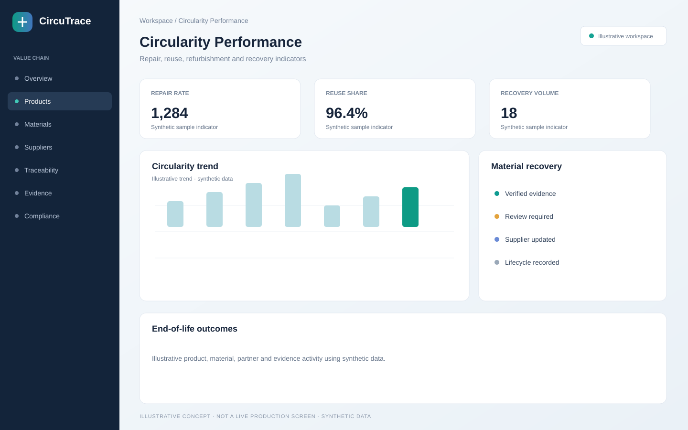

### 10. Battery Passport Workspace
Battery composition, lifecycle history, data completeness and access controls.

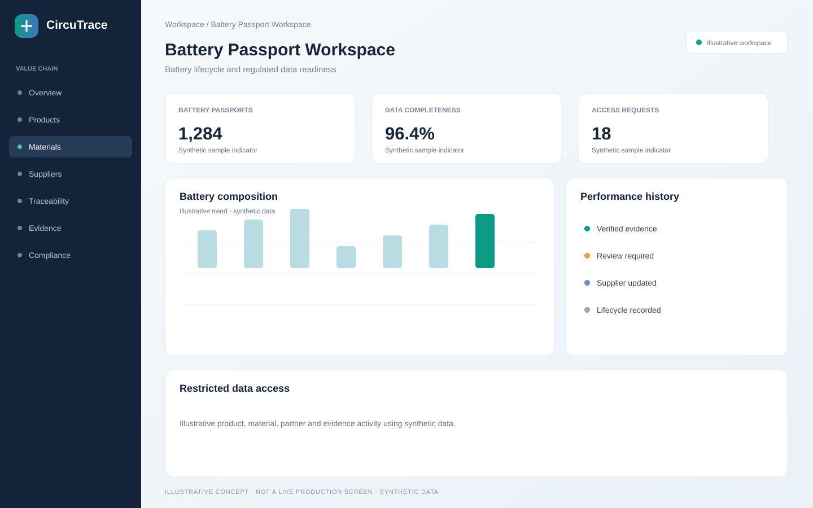

### 11. Public Passport Verification
QR entry, approved disclosures and verification outcomes.

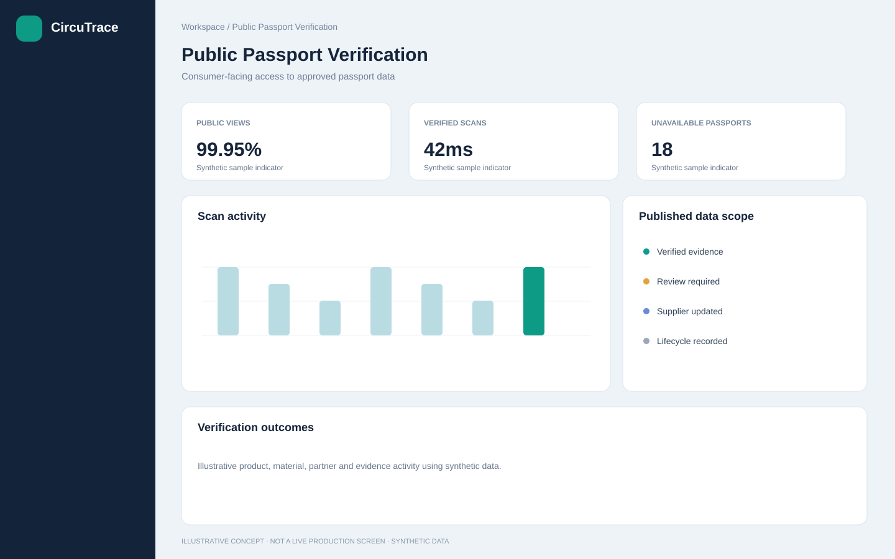

### 12. Audit & Data Quality
Evidence freshness, attributable changes and trust exceptions.

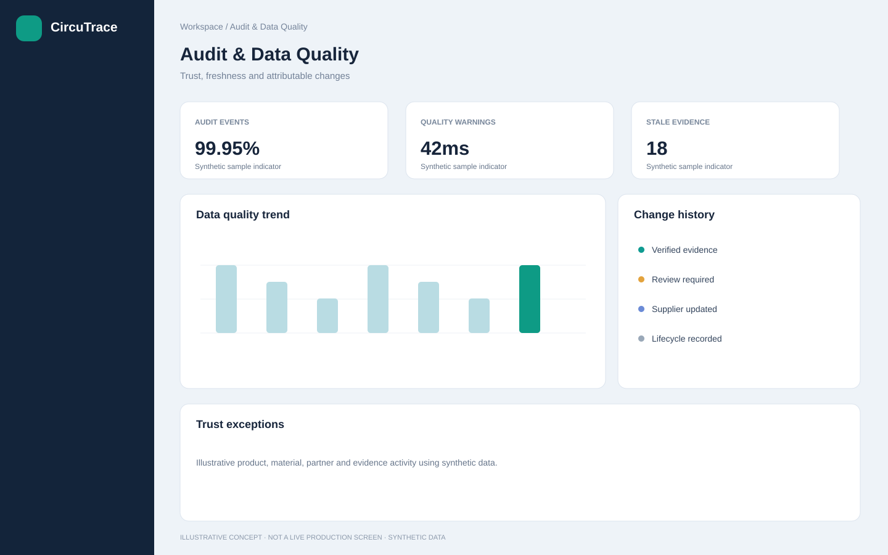

## 9. Roadmap

1. Complete tenant-scoped product and material registry.
2. Add append-only lifecycle events with provenance and idempotency.
3. Introduce evidence versioning, issuer verification and expiry handling.
4. Implement configurable product-group passport schemas and disclosure policy.
5. Add GS1 Digital Link / QR resolution and interoperable export.
6. Add data-quality rules, accessibility, security testing and operational runbooks.

## 10. Contribution and license

See [CONTRIBUTING.md](CONTRIBUTING.md) and [SECURITY.md](SECURITY.md). Unless a license file is added, all rights are reserved.
