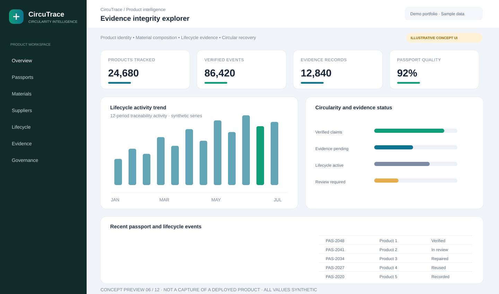
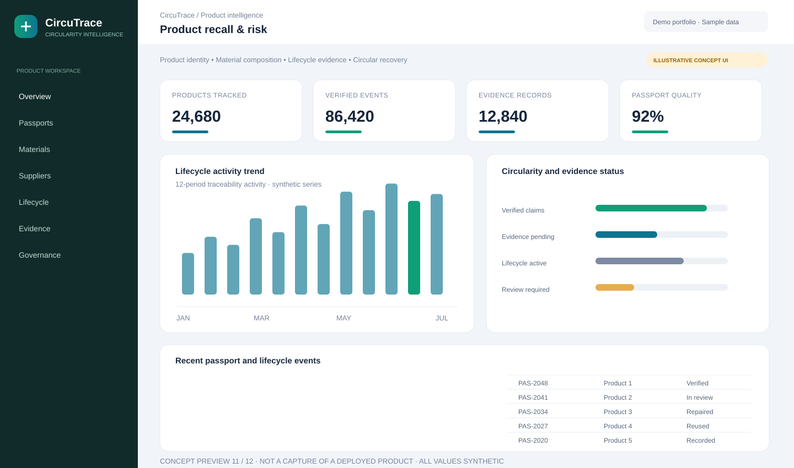

# CircuTrace

**Enterprise Digital Product Passport & Circular Lifecycle Intelligence Platform**

> Make product identity, lifecycle events and circularity evidence traceable across the value chain.

## 1. Product overview

CircuTrace is an enterprise platform concept for managing trusted product information across design, sourcing, manufacturing, distribution, use, repair, reuse, refurbishment and end-of-life recovery.

## 2. Current implementation

- Product, component and material registry foundations.
- Append-oriented lifecycle event history across product lifecycle stages.
- Circularity metrics and JSON product passport export.
- Allowlisted passport serialization and private/no-store response controls.
- Evidence ledger with SHA-256 record chaining and sequence verification.
- Tenant-scoped product evidence APIs and verification documentation.

**Verification boundary:** the evidence ledger verifies stored ledger metadata and hash-chain consistency. It does not independently fetch external files to validate their supplied digest or verify supplier signatures/certificates. The current DS evidence state must not be presented as independently verified source evidence. Organization authorization and production readiness require further review.

## 3. Technology stack

React 19 · TypeScript · Vite · Node.js · Express 5 · MongoDB · Mongoose · Zod · pnpm 9.15.4 · Turborepo.

## 4. Architecture

- `apps/web`: React product and partner workspace.
- `apps/api`: Express API, product domain, lifecycle and evidence services.
- `packages/shared-types` and `packages/validation`: shared domain types and schemas.
- `docs`: architecture, security, product design and development guides.
- Modular monolith first; split services only when ownership or scale justifies it.

## 5. Local development

Prerequisites: Node.js 22+, pnpm 9.15.4 (Corepack recommended), Docker and MongoDB.

```bash
corepack enable
pnpm install
cp apps/api/.env.example apps/api/.env
cp apps/web/.env.example apps/web/.env
# Configure a unique AUTH_ACCESS_TOKEN_SECRET and local MONGODB_URI.
docker compose up -d mongodb
pnpm dev
```

Web commonly runs at `http://localhost:5173`; API health commonly runs at `http://localhost:4000/api/v1/health`.

Quality checks:

```bash
pnpm lint
pnpm typecheck
pnpm test
pnpm build
pnpm format:check
```

## 6. Security and responsible data handling

Tenant isolation and server-side authorization must be enforced at every data boundary. Treat supplier declarations, evidence URLs, product data and imported files as untrusted. Use HTTPS for evidence references, bound payload size, retain audit metadata without unnecessary sensitive data, and never commit signing keys or credentials. MongoDB transactions require replica-set or sharded-cluster support. Use synthetic data in demos and obtain qualified legal/domain review before making regulatory or environmental claims.

## 7. Illustrative dashboard gallery

These 12 views are **illustrative SVG dashboard concepts**, not screenshots captured from a running deployment. They contain synthetic sample values and do not establish that every depicted feature is implemented. They are arranged in a single vertical column for full-width inspection.

### 01. Circularity command center

Circularity command center concept summarizing product volumes, lifecycle stage distribution, evidence coverage and recovery outcomes. All values are synthetic.


### 02. Digital product passport

Digital product passport concept presenting approved identity, composition, provenance, lifecycle summary and public disclosure status. All product data is synthetic.


### 03. Product & material registry

Product and material registry concept for SKUs, variants, components, material declarations and traceability completeness. All records are synthetic.


### 04. Supplier provenance network

Supplier provenance network concept showing supplier relationships, origin declarations, evidence status and unresolved verification gaps. All organizations are illustrative.


### 05. Lifecycle event ledger

Lifecycle event ledger concept for manufacture, transfer, repair, refurbishment, reuse, recycling and disposal events with accountable timestamps. All events are synthetic.


### 06. Evidence integrity explorer

Evidence integrity explorer concept for document provenance, version history, attestations, review state and integrity checks. All evidence is illustrative.



### 07. Repair & refurbishment

Repair and refurbishment workspace concept tracking service history, replaced components, condition and next-life readiness. All product records are synthetic.


### 08. Circularity performance

Circularity performance view concept comparing reuse, repair, recovery and material-loop indicators with transparent calculation context. All metrics are synthetic.


### 09. Compliance & claim review

Compliance and claim review workspace concept linking sustainability claims to supporting evidence, reviewers and decision states. It does not certify compliance.


### 10. Public passport verification

Public passport verification concept showing only approved disclosure fields and a verifiable product identity summary. All example information is synthetic.


### 11. Product recall & risk

Product recall and risk workspace concept for affected batches, component relationships, risk signals and accountable response actions. All records are synthetic.



### 12. Circular partner ecosystem

Circular partner ecosystem concept showing manufacturers, repairers, logistics providers and recyclers connected through controlled data exchange. All partners are illustrative.


## 8. Engineering quality

GitHub Actions provides build/test automation, CodeQL, secret scanning and dependency auditing. Review current advisory results before release. Committed lockfiles and frozen dependency installs are enforced in CI; the latest audit reports zero known vulnerabilities. Remaining engineering priorities include ongoing advisory monitoring, tenant authorization integration tests, end-to-end accessibility coverage, immutable action pinning, operational monitoring and backup/restore testing.

## 9. Documentation

- [Architecture overview](docs/architecture/overview.md)
- [Local development](docs/development/local-setup.md)
- [Tenant isolation](docs/security/tenant-isolation.md)
- [Verifiable passport evidence ledger](docs/product/verifiable-passport-evidence-ledger.md)

## 10. Roadmap

1. Complete organization membership and tenant-scoped authorization.
2. Strengthen evidence verification with external-byte digest validation and independently managed issuer trust roots.
3. Expand lifecycle and partner workflow integration tests.
4. Commit and enforce frozen pnpm lockfiles and remediate remaining advisories.
5. Add browser E2E tests, accessibility checks, observability and production runbooks.

## 11. Responsible claims

CircuTrace supports evidence management and operational workflows; it does not independently certify products, guarantee supplier claims or establish legal compliance. Regulatory applicability and required evidence must be determined by qualified stakeholders.
